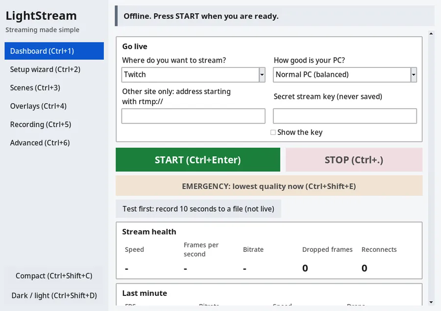
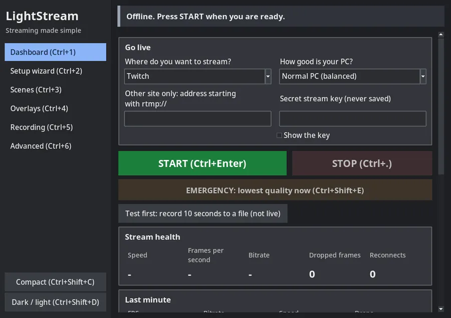

# lightstream

[](https://github.com/MiChaelinzo/lightweight-livestream/actions/workflows/ci.yml)


<p align="center">
  
  
</p>
<p align="center"><sub>Real screenshots, rendered on Linux under Xvfb; fonts differ on Windows.</sub></p>

**Go live from an old PC without the lag.** lightstream is a tiny launcher for old laptops and PCs where OBS stutters while you play light games such as Arknights or Limbus Company. It needs only Python and FFmpeg.

- **One window, 3 steps.** Pick a site, paste your key, pick your PC strength, press START.
- **Lean by design.** One low-delay FFmpeg command, no B-frames, small buffer, hardware encoder when a test encode proves it works.
- **Plays nice.** Runs at low priority so your game wins.
- **Hard to break.** Reconnects with backoff, falls back to software encoding if a GPU encoder fails, and never prints or saves your key.
- **Safe to try.** `--test-local` records 10 seconds to a file instead of going live. `--mute` sends silence.
- Streams to Twitch, YouTube, Facebook Live (RTMPS) or any custom RTMP or SRT server.
- **New in 0.16:** opt-in `--guardian` and `--auto-survival` (off by default; every step restarts the encoder), a bandwidth trend predictor (synthetic tests only), a session timeline in the end-of-session output, profiles `potato_pc`, `office_laptop` and `budget_gaming`, idle budgets (startup, RSS, CPU) measured under Xvfb. Real machines UNVERIFIED. See [docs/architecture/V016-MAP.md](docs/architecture/V016-MAP.md).
- **New in 0.15:** eight GUI themes and a reduce-motion setting, `lightstream audio-check`, Teaching and Meeting audio profiles, copilot insights, `lightstream highlights` (heuristic clips, 9:16 export) and `dashboard`, a plugin runtime (`lightstream plugins`, not yet connected to `start`) and `tools/benchlab.py` (OBS and Streamlabs columns are UNKNOWN). Details in [docs/FEATURES.md](docs/FEATURES.md) and the [CHANGELOG](CHANGELOG.md).
- **In 0.14:** the health score uses the real dropped-frame percent, the Recording page has a persistent-ingest checkbox, the GUI banner states can be rendered for review, and this README is shorter (details moved to [docs/FEATURES.md](docs/FEATURES.md)). Earlier highlights are listed there and in the [CHANGELOG](CHANGELOG.md). Real platforms, Windows and macOS are UNVERIFIED; see [docs/ROADMAP.md](docs/ROADMAP.md) for the honest status of each area.

**More:** [Features and guides](docs/FEATURES.md) | [Documentation index](docs/README.md) | [Roadmap](docs/ROADMAP.md) | [Benchmarks](docs/BENCHMARKS.md) | [Web showcase](web/)

## Download (no Python, no Git)

Get the app from the [Releases page](https://github.com/MiChaelinzo/lightweight-livestream/releases). The release workflow is UNVERIFIED (never run yet), so a release may not exist until the maintainer publishes one.

| Platform | Download | How to start |
|---|---|---|
| Windows | `LightStream-0.16.0-windows-portable.zip` | Unzip, double-click `LightStream.exe` |
| macOS | `LightStream-0.16.0-macos.zip` (or `.dmg`) | Open it, move `LightStream.app` to Applications, right-click > Open (Apple Silicon only, no Intel build) |
| Linux | `LightStream-0.16.0-linux-x86_64.tar.gz` | `tar xzf` it, run `./LightStream` from a desktop session (needs a glibc as new as Ubuntu's current runner image; older distros may fail) |

- **FFmpeg is not included.** On first run the app tells you if it is missing and offers a download link and a "Choose ffmpeg file..." button.
- **Windows SmartScreen** may say "Windows protected your PC" because the app is unsigned. Click More info, then Run anyway. **macOS** may block it: right-click > Open, or run `xattr -d com.apple.quarantine LightStream.app`.
- Android, iOS, `.msi`, `.deb`, `.rpm` and AppImage are not provided. See [docs/RELEASING.md](docs/RELEASING.md).

Prefer Python? Use the steps below instead.

## Quick start (3 steps)

1. Install: `pip install .` (or `export PYTHONPATH=src`).
2. Check: `lightstream doctor`.
3. Go: `lightstream gui` for the window, or the commands below.

```sh
pip install .                       # or: export PYTHONPATH=src
lightstream doctor                  # checks ffmpeg and your encoder
lightstream gui                     # the easy window
# or the command line:
lightstream start --test-local      # record 10 seconds, nothing goes live
STREAM_KEY=your_key lightstream start --platform twitch --preset light
```

Installing also gives you the `lightstream-gui` command. No install? Use `python -m lightstream ...` with `PYTHONPATH=src`.

## Easiest way: the window app

No typing commands needed. If you are a kid, ask a parent to help with steps 1 to 3 once. After that it is just click and go.

### Alternative: one-time setup with Python (Windows)

1. **Install Python.** Download it from [python.org](https://www.python.org/downloads/) (3.8 or newer). In the installer, tick **"Add Python to PATH"**, then click Install.
2. **Install FFmpeg** (the part that sends your video). Download it from [gyan.dev](https://www.gyan.dev/ffmpeg/builds/), unzip it, and put `ffmpeg.exe` in a folder that is on your PATH.
3. **Get this project.** On GitHub press Code, then Download ZIP, then unzip it.
4. **Double-click `launchers\start-gui.bat`.** The window opens.

On Linux or macOS, run `./launchers/start-gui.sh` (or `lightstream gui` after `pip install .`).

### Every time you stream

1. Pick **where to stream** (Twitch, YouTube, Facebook Live or Other site).
2. Paste your **secret stream key** (see "Where do I find my stream key?" below).
3. Pick **how good your PC is**. Not sure? Choose **Old PC (light)**.
4. Press the big green **START** (or press Enter).
5. Want to check first? Press **Test first** to record 10 seconds to `lightstream-test.mkv` without going live.
6. Wait for the banner to say **YOU ARE LIVE!** Then open your game.
7. Press the red **STOP** when you are done. Closing the window also stops the stream.

What the window looks like, with ASCII layouts of the Offline and LIVE states and banner colors, is in [docs/FEATURES.md](docs/FEATURES.md#what-the-window-looks-like).

### Where do I find my stream key?

- **Twitch:** log in, open your Creator Dashboard, then Settings, then Stream. Press "Copy" next to Primary Stream key.
- **YouTube:** open YouTube Studio, press Create, then Go live, then Stream. Copy the Stream key (you may need to enable live streaming first, which can take up to 24 hours).
- **Other site:** use the address the site gives you (it starts with `rtmp://`) and its key.

Parent tip: the key is like a password for the channel. Keep it private, and if it ever leaks, reset it on the site. Lightstream never saves the key and never prints it in its log.

### Something went wrong? (plain words)

| What you see | What it means | What to do |
|---|---|---|
| The window does not open | Python has no window support (tkinter) or there is no screen | Windows: reinstall Python and keep "tcl/tk" ticked. Linux: install the `python3-tk` package. Or use the command line below |
| "ffmpeg not found" or Check my PC says missing | FFmpeg is not installed where the PC can find it | Redo setup step 2 and restart the window |
| Banner is red: Problem | The stream could not start | Read the red "What is wrong?" text under the banner. Check the key and your internet |
| Twitch or YouTube says no signal | Wrong key, or the wrong site was picked in step 1 | Copy the key again, pick the right site |
| Orange: Reconnecting | Your internet blinked | Wait. It tries again by itself. After 5 quick failures in a row it stops, and the advanced option "Keep trying if the internet drops" makes it never give up |
| LIVE, but your PC is struggling | The PC cannot keep up | Press STOP, choose a weaker setting in step 3, close other programs, start again |
| Viewers see a black picture | The capture cannot see your game window (common with BlueStacks, LDPlayer, MuMu) | Leave the advanced "Window title" empty to share the whole screen, or switch the emulator to DirectX or software rendering |
| No sound | Audio device not found | Run `lightstream devices`, then type the name in advanced options. Tick "Mute" for silence on purpose |

Still stuck? Press **Check my PC** and read the answer, or ask a parent to try the command line below.

## Command line (for advanced users)

### Windows

1. Open `launchers\start-stream.bat` in Notepad, set `PLATFORM` (`twitch`, `youtube` or `facebook`) and `PRESET`, save.
2. Double-click it, paste your stream key when asked, and play. Press Ctrl+C to stop.

Check your setup any time: `python -m lightstream doctor` (with `set PYTHONPATH=src`), or `pip install .` once, then use `lightstream doctor`.

### Linux / macOS

```sh
pip install .            # or: export PYTHONPATH=src
lightstream doctor
STREAM_KEY=your_key lightstream start --platform twitch --preset light
# or: ./launchers/start-stream.sh twitch light
```

## Presets

| Preset | Resolution | FPS | Video kbps | Use for |
|---|---|---|---|---|
| `potato` | 640x360 | 24 | 700 | oldest PCs, weak Wi-Fi, emulators |
| `light` (default) | 854x480 | 30 | 1000 | old laptops, Arknights, Limbus Company |
| `balanced` | 1280x720 | 30 | 2500 | decent PCs or hardware encoder |
| `720p60` | 1280x720 | 60 | 4000 | fast games, needs a good PC |

Override anything: `--fps 30 --res 960x540 --bitrate 1500`. Invalid values (such as `--fps 0` or a negative `--bitrate`) are rejected. If FFmpeg keeps failing, lightstream gives up after 5 quick failures in a row. Settings priority: command line, then config file (`lightstream init` writes an example), then preset.

## Arknights / Limbus Company tips

- **Mobile emulator** (BlueStacks, LDPlayer, MuMu): use `--preset potato` or `light` and `--window "exact window title"` (Windows) so only the game is captured, not your whole desktop.
- Run the game windowed or borderless, not exclusive fullscreen.
- Both games are fine at 30 FPS (or 24 with `potato`). Higher FPS costs CPU and gains little.
- Lower the emulator's own FPS and resolution and give it fewer CPU cores, leaving one for streaming.
- Close browsers and other apps. Use wired ethernet if you can.
- If it still lags, drop to `potato`, then lower `--bitrate`. A hardware encoder (NVIDIA, Intel QuickSync, AMD) is used only if a tiny test encode succeeds on your machine, otherwise it falls back to software `libx264`; if it later fails twice in a row with an error naming the encoder, the stream switches to `libx264` (wrong keys or network drops do not trigger this); use `--software` to skip hardware, or `--encoder NAME` to force one.
- **Black picture?** `--window` uses Windows gdigrab, which often captures black for hardware-accelerated emulator windows (BlueStacks, LDPlayer, MuMu). If so, drop `--window` to capture the whole desktop, or try the emulator's DirectX/software render mode.
- Window and desktop captures keep their aspect ratio and get black bars when it differs from the preset, instead of being stretched.
- Audio: run `lightstream devices` (Windows, macOS) to list names, then pass `--audio-device "Device name"` (macOS wants the index). Without it, Windows streams silent audio. `--mute` forces silence on any OS.

## More features

Hardware profiles, scenes and webcam overlay, recording a copy, noise suppression, bandwidth optimizer, performance profiles, Emergency and backup ingest, insights and auto-scale, the sidebar window and the browser companion are described in [docs/FEATURES.md](docs/FEATURES.md), with their status tables.

## Stream key safety

The key is read from the `STREAM_KEY` environment variable or typed at a hidden prompt (asked by lightstream itself, also from the Windows launcher). It is never stored by lightstream, and it is hidden (`****`) in everything lightstream prints. Limitation: RTMP puts the key in the FFmpeg command line, so other local processes running as your user may be able to see it in the process list. Custom URLs that carry their own tokens are not redacted beyond the key. Never share your key or commit it.

## Commands

`lightstream doctor`, `devices`, `presets`, `profiles`, `init`, `gui`, `setup [--yes] [--platform NAME] [--upload-mbps N]`, `bandwidth [--platform NAME] [--upload-mbps N | --measure-url URL] [--hardware NAME]`, `scenes list|validate|example|export|import [--scenes-file FILE]`, `start [--platform twitch|youtube|facebook|custom] [--url URL] [--preset NAME] [--fps N] [--res WxH] [--bitrate K] [--window TITLE] [--audio-device NAME] [--video-device INDEX] [--mute] [--test-local [FILE]] [--keep-trying] [--encoder NAME] [--software] [--scene NAME] [--scenes-file FILE] [--record [FILE]] [--no-record] [--analytics] [--profile NAME] [--stream-preset NAME] [--audio-profile NAME] [--noise off|light|ai] [--noise-model PATH] [--hardware auto|intel_hd|intel_hd_optimized|nvidia_mx|mx250_streamer|optimus_mx250|nvidia|generic] [--potato-stream 2000|4000] [--grayscale] [--skip-static] [--rate-mode vbr|cbr] [--persistent-ingest] [--guardian] [--auto-survival] [--dry-run]`

`--keep-trying` never gives up reconnecting. `--video-device` (macOS) picks the screen. On Linux the capture follows `$DISPLAY`.

`--dry-run` prints the FFmpeg command without streaming. `--test-local [FILE]` records 10 seconds (default `lightstream-test.mkv`) and needs no stream key.

## Web demo (Vercel)

`web/` is a separate static site: a 3D hero, a preset picker that estimates upload need and data use, install steps and a local screen-recording demo. It is a guide and calculator only, cannot stream, and never asks for a stream key. Deploy steps, preset export and its verification table are in [docs/FEATURES.md](docs/FEATURES.md#web-demo-vercel). Web rendering in headless Chromium (1280 and 390 px, light and dark) is VERIFIED (Chromium only); a WebGL hero on a real GPU, Firefox and Safari are UNVERIFIED.

## Verification status

| Item | Status | Evidence |
|---|---|---|
| GUI controller logic (validation, banner states, prefs, key never saved or logged) | VERIFIED | unit tests, no display needed |
| GUI window rendering on Linux (layout, fonts, buttons, colors) | PARTIALLY VERIFIED (Linux only) | real screenshots captured under Xvfb with `tools/ui_snapshots.py` (see [docs/DEV-RENDERING.md](docs/DEV-RENDERING.md)); read by eye, no automated pixel assertions |
| GUI look on Windows and macOS, real fonts and DPI scaling | UNVERIFIED | never run on those systems |
| GUI callback crash capture in a live Tk window | UNVERIFIED | the report function is unit tested; the Tk hook was not exercised on a display |
| Command building (all OSes, encoders) | VERIFIED (as strings) | unit tests |
| Preset, config precedence, key handling | VERIFIED | unit tests |
| Key redaction in printed output | VERIFIED | unit tests, dry run |
| Reconnect/backoff, stop, status and stats parsing | VERIFIED (fake process) | unit tests |
| Mute, `--test-local` command, audio device list parsing (sample text) | VERIFIED (as strings) | unit tests; real device output may differ |
| Encoder-failure detection (known FFmpeg messages) | VERIFIED (sample lines) | unit tests; real FFmpeg wording may vary by version |
| CI on Linux and Windows, Python 3.9 to 3.12 | UNVERIFIED | workflow added, not yet run on GitHub |
| Test-encode fallback and retry cap logic | VERIFIED (fake process) | unit tests; no real GPU or FFmpeg run |
| `--help` flags match this README | VERIFIED | checked against `lightstream start --help` |
| Real capture and streaming with real FFmpeg | UNVERIFIED | no FFmpeg, display or network in dev sandbox |
| Hardware encoder flags (NVENC, QSV, AMF, VAAPI, VideoToolbox) | UNVERIFIED | never run on real hardware |
| Windows window capture, dshow audio, low priority | UNVERIFIED | not run on Windows |
| Actual lag/CPU improvement vs OBS | UNVERIFIED | not measured |
| Performance profiles, stream presets, audio profile selection, thread math, optimizer rules, network stability score, auto-scale ladder and hysteresis, readiness scoring, bench report schema (0.9.0) | VERIFIED | unit tests with fake clocks and injected callables |
| Ten audio filter chains accepted by FFmpeg (0.9.0) | VERIFIED | run through ffmpeg 7.0.2 static build on a sine input in the dev sandbox; a bad chain was rejected |
| Real libx264 synthetic encode and bench numbers (0.9.0) | VERIFIED (this machine only) | `docs/BENCHMARKS.md`, Linux x86_64 sandbox; not representative of low-end laptops |
| Restart through the reconnect path (auto-scale) | PARTIALLY VERIFIED | exercised against a real subprocess, not a real capture or RTMP stream |
| Auto-scale on real games and streams, threshold fit to real hardware | UNVERIFIED | not run |
| Game FPS gain from Gaming First (thread cap, CPU affinity) | UNVERIFIED | not measured |
| Telemetry on Windows and macOS, `nvidia-smi` GPU readings, GUI telemetry row and new controls | UNVERIFIED | Linux parsing tested on sample text only; no display |
| Linux PyInstaller build (`tools/build_release.py`), tar.gz plus SHA256SUMS, runs headless and prints the no-screen message | VERIFIED | built for 0.8.0 with PyInstaller, extracted and run locally (GUI itself not shown, no display) |
| Windows `.exe` zip, macOS `.app` zip and `.dmg` | UNVERIFIED | only tested with a faked PyInstaller |
| Release workflow `release.yml` | UNVERIFIED | YAML parses; Actions is billing-locked, never run |
| First-run FFmpeg dialog on a real GUI | UNVERIFIED | no display; guidance and validator logic are unit tested |

## Known limitations, portable mode and standalone builds

See [docs/FEATURES.md](docs/FEATURES.md#known-limitations) for the limitations list, [portable mode](docs/FEATURES.md#portable-mode-usb-stick-friendly) and [building a standalone app](docs/FEATURES.md#build-a-standalone-app-optional). Key points: Windows window capture can show black for GPU emulators, RTMP only, and the stream key is visible to local processes in the FFmpeg command line. The zipapp recipe is VERIFIED on Linux; the PyInstaller recipe is UNVERIFIED.

## Development

```sh
python3 -m unittest discover -s tests -v
python3 -m compileall -q src
```

```sh
node --test "web/test/*.test.js"
```

CI runs the same commands on Linux and Windows (`.github/workflows/ci.yml`).
